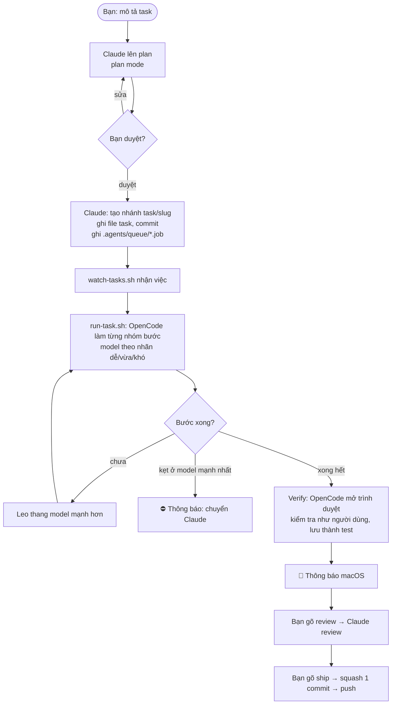

# claude-opencode-kit

> **Claude lên plan và review. OpenCode code và test. Bạn chỉ duyệt.**
>
> A small kit that turns Claude Code (planner/reviewer) + OpenCode (cheap executor) into an automatic
> two-agent workflow: plan → hand-off → step-by-step implementation with model escalation → browser
> verification → review → squash & ship. Docs are in Vietnamese.

Bộ công cụ nhỏ (vài script bash + file hướng dẫn cho agent) để chia việc code giữa hai agent:

- **Claude Code** (gói Claude Pro/Max): việc cần suy nghĩ — lên plan, review, gỡ chỗ kẹt.
- **OpenCode** (ví dụ gói OpenCode Go): việc tốn nhiều token — viết code, chạy test, tự kiểm tra trên trình duyệt.

Mục tiêu: **quota Claude kéo dài hơn nhiều lần**, trong khi chất lượng vẫn được Claude kiểm soát ở đầu (plan) và cuối (review).

---

## Mục lục

- [Cách hoạt động](#cách-hoạt-động)
- [Yêu cầu](#yêu-cầu)
- [Cài đặt](#cài-đặt)
- [Thiết lập lần đầu cho project](#thiết-lập-lần-đầu-cho-project)
- [Dùng hằng ngày](#dùng-hằng-ngày)
- [File task](#file-task)
- [Nhãn độ khó, model và leo thang](#nhãn-độ-khó-model-và-leo-thang)
- [Verify trên trình duyệt](#verify-trên-trình-duyệt)
- [Nhánh, review và ship](#nhánh-review-và-ship)
- [Cấu hình](#cấu-hình)
- [Log và đo thời gian](#log-và-đo-thời-gian)
- [Xử lý sự cố](#xử-lý-sự-cố)
- [Cấu trúc repo](#cấu-trúc-repo)

---

## Cách hoạt động



Hai agent không nói chuyện trực tiếp. **Mọi context nằm trong repo**:

| File | Vai trò |
|---|---|
| `AGENTS.md` | Kiến thức cố định về project: kiến trúc, lệnh, quy ước, quy tắc test. Mọi agent đều đọc. |
| `CLAUDE.md` | `@AGENTS.md` + hướng dẫn riêng cho Claude: định dạng plan, cách giao việc, review, ship. |
| `.agents/tasks/<task>.md` | Plan, ngữ cảnh, test cases, trạng thái, kết quả test và Verify của một task. |
| `.agents/queue/*.job` | "Hộp thư" Claude dùng để giao việc cho OpenCode. |
| Git | Mỗi bước một commit trên nhánh `task/<slug>`; ship thì gộp thành một commit. |

---

## Yêu cầu

- macOS hoặc Linux, `bash`, `git` (thông báo desktop chỉ có trên macOS)
- [Claude Code](https://code.claude.com/docs/en/setup) đăng nhập bằng gói Claude (Pro/Max)
- [OpenCode](https://opencode.ai) đã `/connect` với một nhà cung cấp model (ví dụ OpenCode Go)
- Node.js + [Playwright Test](https://playwright.dev) cho e2e test
- [`playwright-cli`](https://playwright.dev/docs/getting-started-cli) cho bước Verify: `npm install -g @playwright/cli@latest`
- Terminal chia đôi được (iTerm2, Zed, tmux...)

---

## Cài đặt

```bash
git clone https://github.com/<you>/claude-opencode-kit.git
cd claude-opencode-kit
./install.sh /path/to/your-project
```

Installer:

- **luôn cập nhật** `scripts/run-task.sh`, `scripts/watch-tasks.sh`, `scripts/log-gaps.sh` (chạy lại để nâng cấp kit);
- **chỉ tạo nếu chưa có** `CLAUDE.md`, `AGENTS.md`, `.agents/config.sh`, `.agents/tasks/_TEMPLATE.md` (`--force` để ghi đè);
- thêm `.agents/queue/`, `.agents/run.log`, `test-results/`, `playwright-report/` vào `.gitignore`.

> Project đã có `CLAUDE.md`? Installer giữ nguyên file cũ. Hãy chép phần **Handoff to OpenCode** từ
> `template/CLAUDE.md` vào cuối file của bạn và thêm dòng `@AGENTS.md` ở đầu.

---

## Thiết lập lần đầu cho project

**1. Sửa `.agents/config.sh`** — model cho từng nhãn, URL dev cho Verify, agent chạy gì sau mỗi bước. Xem [Cấu hình](#cấu-hình).

**2. Điền `AGENTS.md`.** Mở OpenCode ở thư mục project, dán prompt trong [`prompts/generate-agents-md.md`](prompts/generate-agents-md.md). Đọc lại và sửa tay — file này mọi agent đọc ở mọi phiên, đáng 10 phút.

**3. Playwright Test** (nếu chưa có):

```bash
npm init playwright@latest   # TypeScript, thư mục tests, không GitHub Actions, cài browser
rm -f tests/example.spec.ts && rm -rf tests-examples
```

Rồi chỉnh `playwright.config.ts` theo [`examples/playwright.config.ts`](examples/playwright.config.ts). Bắt buộc có reporter JSON ra `test-results/results.json`.

**4. (Nên có) Test hook.** Một object như `window.__APP__` chỉ bật với `?test=1`, cho test đọc/set state thay vì click qua cả chuỗi màn hình. Có thể để Claude làm như task đầu tiên. Ghi cách dùng vào dòng "Test hook" trong `AGENTS.md`.

**5. Commit:**

```bash
git add -A && git commit -m "chore: add claude-opencode-kit"
```

**6. Kiểm tra Claude đọc được AGENTS.md:** chạy `claude`, hỏi *"Codebase map của project này là gì?"*.

---

## Dùng hằng ngày

Chia terminal làm đôi, cả hai ở thư mục project:

| Ô trái | Ô phải |
|---|---|
| `scripts/watch-tasks.sh` | `claude` → `/model` chọn Sonnet → Shift+Tab tới **plan mode** |

> Mẹo: để `npm run dev` chạy sẵn ở một ô thứ ba — Playwright dùng lại server, mỗi bước nhanh hơn nhiều.

1. **Ô phải:** mô tả task (mẫu trong [`prompts/plan-task.md`](prompts/plan-task.md)).
2. **Duyệt plan.** Claude tự tạo nhánh, ghi file task, commit, giao việc — rồi dừng.
3. **Ô trái** tự chạy. Màn hình hiện tóm tắt:

   ```
   ▶ Bước 1–2/5  [vừa] glm-5.3
     1. client/src/ui/OrdersPanel.ts → recipeSteps: ...
     2. client/src/style.css → .order .part-into: ...
       ← Edit client/src/ui/OrdersPanel.ts
       $ npm run typecheck
     ● feat(orders): show container line last
      client/src/ui/OrdersPanel.ts | 6 +++---
     ✓ Bước 1 xong
     ✓ Bước 2 xong
     ⏱  2m10s
   ```

4. **Thông báo macOS** "OpenCode đã xong ✅" → ô phải: `/clear`, gõ `review`.
5. Ổn thì gõ `ship` → gộp thành 1 commit trên `main` và push.

Gặp "OpenCode cần trợ giúp ⛔": script in sẵn câu để dán cho Claude. Claude sửa xong, giao lại phần còn lại:

```bash
echo .agents/tasks/<file>.md > .agents/queue/$(date +%s).job
```

Chạy tay không qua watcher: `scripts/run-task.sh .agents/tasks/<file>.md` (script tự tiếp tục từ bước chưa tick).

---

## File task

Template: [`template/.agents/tasks/_TEMPLATE.md`](template/.agents/tasks/_TEMPLATE.md). Claude viết, OpenCode cập nhật.

```markdown
# Task: Đưa dòng tô/đĩa/ly xuống cuối công thức

## Mục tiêu
## Quyết định đã chốt
## Ngữ cảnh                 ← Claude ghi sẵn file/hàm/type cần biết, OpenCode khỏi tự tìm
## Plan
- [ ] 1. [dễ] client/src/ui/OrdersPanel.ts → recipeSteps: ...
- [ ] 2. [vừa] tests/orders-panel.spec.ts: viết T1–T2
## Test cases
- [ ] T1. Vật chứa nằm cuối — .part-into là bước cuối — tests/orders-panel.spec.ts
## Trạng thái hiện tại
## Test status              ← từng test: PASS / FAIL / chưa viết
## Verify                   ← bước Verify tự điền, dòng cuối VERIFY: PASS|FAIL
## Đã thử mà không được     ← agent ghi khi kẹt, để agent sau không lặp lại
## Số liệu
```

Script nhận diện bước bằng mẫu `- [ ] N. [nhãn] ...` — giữ đúng định dạng này.

---

## Nhãn độ khó, model và leo thang

| Nhãn | Ý nghĩa (Claude gắn khi lên plan) | Model mặc định |
|---|---|---|
| `[dễ]` | 1 file, thay đổi cơ học | `MODELS[0]` |
| `[vừa]` | vài file, theo pattern có sẵn | `MODELS[1]` |
| `[khó]` | thiết kế mới, xuyên nhiều tầng, logic đồng bộ | `MODELS[2]` |

- **Gom bước:** các bước liên tiếp cùng nhãn chạy trong **một** phiên OpenCode (tối đa `BATCH_MAX`), để agent không phải đọc lại context ở mỗi bước.
- **Nối phiên:** từ lần chạy thứ hai, script dùng `opencode run --continue`, nên model sau vẫn thấy những gì model trước đã đọc/làm (`REUSE_SESSION=0` để tắt).
- **Leo thang:** bước chưa được tick sau khi chạy → chạy lại riêng bước đó với model mức trên. Kẹt ở `[khó]` → dừng, chuyển Claude.
- **Bảo vệ quota:** tổng số lần gọi OpenCode cho một task tối đa `MAX_RUNS`.

Script chọn model bằng cách đọc chữ `[dễ]`/`[vừa]`/`[khó]` trong dòng plan — model không "biết" nhãn. Đổi model trong `.agents/config.sh`.

---

## Verify trên trình duyệt

Sau khi mọi bước đã tick, một agent (`VERIFY_MODEL`, cần đọc được ảnh) dùng `playwright-cli`:

1. chạy toàn bộ e2e test, ghi kết quả từng test;
2. mở app ở `VERIFY_URL` (nhiều session nếu là tính năng nhiều người dùng);
3. kiểm tra từng ý trong *Mục tiêu* và *Test cases*, chụp ảnh;
4. ghi mục `## Verify` (PASS/FAIL, đường dẫn ảnh);
5. **lưu mọi kịch bản đã kiểm tra thành spec** — lần sau `npx playwright test` tự bắt lỗi, không tốn token;
6. không sửa code app.

Bỏ qua Verify cho một lần chạy: `VERIFY=0 scripts/run-task.sh ...`

Test e2e chạy **headless** (không hiện cửa sổ). Muốn xem: `npx playwright test --ui` (timeline từng bước kèm ảnh) hoặc `--headed`; với config mẫu, `HEADED=1` để luồng tự động cũng hiện cửa sổ.

---

## Nhánh, review và ship

```
main ──●──────────────────────────────●  feat(orders): show container line last
        \                            ↑ ship: squash 1 commit + push
         task/orders-container-last ─●─●─●─●  (plan, từng bước, verify)
```

- Claude tạo nhánh `task/<slug>` trước khi commit plan. Nếu `run-task.sh` được chạy khi đang ở `main`, nó tự chuyển sang `task/<tên-file>`.
- `review`: Claude đọc file task + `git diff main...HEAD`, báo lỗi/lệch plan/test thiếu, kết luận có ship được không.
- `ship`: squash merge vào `main`, một commit Conventional Commit, push, xóa nhánh. Push bị từ chối → Claude dừng và báo, **không force push**.

Hướng dẫn đầy đủ cho Claude nằm trong [`template/CLAUDE.md`](template/CLAUDE.md). Mẫu câu: [`prompts/review-and-ship.md`](prompts/review-and-ship.md).

---

## Cấu hình

`.agents/config.sh` (được `source` bởi `run-task.sh`):

| Biến | Ý nghĩa |
|---|---|
| `MODELS=(dễ vừa khó)` | Model cho từng nhãn, dạng `provider/model` (xem `opencode models`) |
| `DEFAULT_VERIFY_MODEL` | Model cho Verify (cần đọc được ảnh) |
| `DEFAULT_VERIFY_URL` | URL app khi chạy dev, có thể kèm `?test=1` |
| `DEFAULT_CHECK_HINT` | Agent chạy gì sau mỗi bước, viết như câu lệnh |
| `DEFAULT_VERIFY_HINT` | Gợi ý thêm cho Verify (ví dụ "luôn mở 2 session") |
| `BATCH_MAX` | Số bước cùng nhãn tối đa trong một lần chạy |
| `MAX_RUNS` | Số lần gọi OpenCode tối đa cho một task |

Biến môi trường ghi đè cho một lần chạy:

| Biến | Mặc định | Tác dụng |
|---|---|---|
| `VERBOSE=1` | 0 | In toàn bộ output thô của OpenCode |
| `ACTIONS=0` | 1 | Ẩn dòng hành động (sửa file, chạy lệnh), chỉ hiện commit |
| `ACTION_REGEX=...` | | Mẫu nhận diện dòng hành động nếu OpenCode in theo định dạng khác |
| `REUSE_SESSION=0` | 1 | Mỗi nhóm bước một phiên OpenCode mới |
| `BATCH_MAX=1` | 4 | Mỗi lần chạy đúng một bước |
| `MAX_RUNS=30` | 20 | Nâng giới hạn cho task lớn |
| `VERIFY=0` | 1 | Bỏ qua Verify |
| `VERIFY_MODEL`, `VERIFY_URL` | | Ghi đè giá trị trong config |

Ví dụ subagent cho OpenCode (tùy chọn, không bắt buộc với script): [`examples/opencode-agents/`](examples/opencode-agents) — chép vào `.opencode/agents/`.

---

## Log và đo thời gian

- Màn hình chỉ hiện tóm tắt; **toàn bộ output** ghi vào `.agents/run.log`, mỗi dòng có giờ và số giây kể từ đầu lần chạy:

  ```
  === 2026-11-21 18:30:02 · bước 1–2 · opencode-go/glm-5.3 ===
  18:30:41 +39s │ ← Edit client/src/ui/OrdersPanel.ts
  18:30:42 +40s │ $ npx playwright test tests/orders-panel.spec.ts
  ```

- Xem trực tiếp: `tail -f .agents/run.log` · xem lại: `less -R .agents/run.log`
- **Tìm chỗ chậm:**

  ```bash
  scripts/log-gaps.sh        # lần chạy gần nhất
  scripts/log-gaps.sh 5      # 5 lần chạy gần nhất (cả task)
  ```

  In thời gian từng lần chạy và các khoảng chờ lâu nhất kèm việc đang diễn ra ngay trước đó (chạy test? typecheck? model đang nghĩ?).

---

## Xử lý sự cố

| Triệu chứng | Nguyên nhân / cách xử lý |
|---|---|
| `Working tree đang có thay đổi chưa commit` | Script chỉ chạy khi repo sạch (để mỗi bước rollback được). Commit/stash trước. Nhớ ignore `.agents/queue/`. |
| `This OpenCode Go model is hosted outside Europe and the United States` | Tài khoản OpenCode đang giới hạn vùng. Console → Settings → Privacy → Regions → Global, hoặc đổi sang model host ở US/EU trong `config.sh`. |
| Ô trái đứng im ở bước đầu | `opencode run` có thể đang chờ cấp quyền. Xem `opencode run --help` / cấu hình permissions của OpenCode. |
| Kết quả lạ khi đổi model giữa chừng | Thử `REUSE_SESSION=0`. |
| Script nối nhầm phiên | `--continue` nối phiên gần nhất trong project — đừng mở `opencode` tương tác ở cùng repo khi script đang chạy (dùng git worktree). |
| Không thấy dòng `← Edit` / `$ ...` | OpenCode in hành động theo định dạng khác. Xem `grep -nE "Edit|Write|Bash" .agents/run.log`, rồi đặt `ACTION_REGEX`. |
| Mỗi bước rất chậm ở phần test | Để `npm run dev` chạy sẵn (`reuseExistingServer: true`). Kiểm tra bằng `scripts/log-gaps.sh`. |
| `claude: command not found` | Cài Claude Code CLI ([hướng dẫn](https://code.claude.com/docs/en/setup)), thêm `~/.local/bin` vào `PATH`. |
| iTerm làm mờ ô không chọn | Settings → Appearance → Dimming → bỏ "Dim inactive split panes". |
| Chạy song song 2 task | Mỗi task một `git worktree` riêng, mỗi worktree một watcher. |

**Lưu ý quyền riêng tư:** model miễn phí/"contributor" của nhà cung cấp có thể lưu dữ liệu — không dùng với code công ty. Kiểm tra tab Privacy của nhà cung cấp.

---

## Cấu trúc repo

```
claude-opencode-kit/
├── install.sh                      # cài/cập nhật kit vào project
├── scripts/
│   ├── run-task.sh                 # chạy các bước của một task + Verify
│   ├── watch-tasks.sh              # chờ việc từ Claude qua .agents/queue
│   └── log-gaps.sh                 # phân tích chỗ chậm trong run.log
├── template/                       # file được chép vào project
│   ├── CLAUDE.md
│   ├── AGENTS.md
│   └── .agents/
│       ├── config.sh
│       └── tasks/_TEMPLATE.md
├── prompts/                        # mẫu prompt
│   ├── generate-agents-md.md
│   ├── plan-task.md
│   └── review-and-ship.md
└── examples/
    ├── playwright.config.ts
    └── opencode-agents/            # subagent mẫu (tùy chọn)
```

## License

MIT
