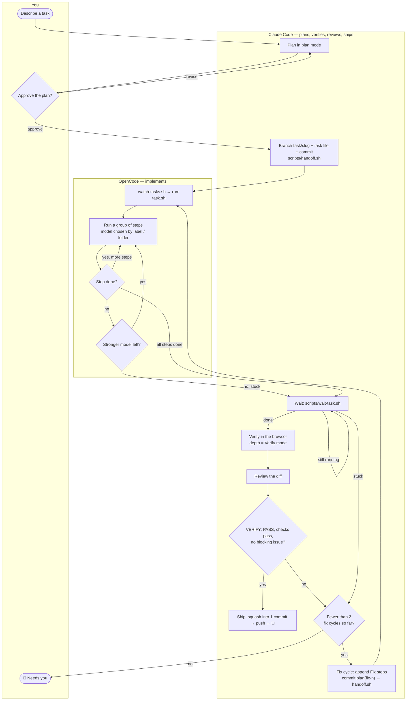

# claude-opencode-kit

> **Claude plans, verifies, reviews and ships. OpenCode codes. You approve the plan — the rest runs on autopilot.**

A small kit (a few bash scripts plus instruction files for the agents) that splits coding work between two agents:

- **Claude Code** (Claude Pro/Max plan): the thinking work — planning, reviewing, getting unstuck.
- **OpenCode** (e.g. the OpenCode Go plan): the token-heavy work — writing code, running tests, checking the feature in a real browser.

The goal: **make your Claude quota last several times longer**, while Claude still controls quality at the start (the plan) and the end (the review).

> **Language note:** the scripts print messages in Vietnamese, and a few conventions use Vietnamese words:
> difficulty labels `[dễ]` = easy, `[vừa]` = medium, `[khó]` = hard; task-file sections such as
> `Mục tiêu` (Goals), `Ngữ cảnh` (Context), `Trạng thái hiện tại` (Current status),
> `Đã thử mà không được` (Tried, didn't work), `Số liệu` (Metrics). Keep these exact strings — the scripts look for them.

---

## Table of contents

- [How it works](#how-it-works)
- [Requirements](#requirements)
- [Installation](#installation)
- [First-time project setup](#first-time-project-setup)
- [Daily use](#daily-use)
- [The task file](#the-task-file)
- [Difficulty labels, models and escalation](#difficulty-labels-models-and-escalation)
- [Browser verification](#browser-verification)
- [Branches, review and ship](#branches-review-and-ship)
- [Configuration](#configuration)
- [Logs and timing](#logs-and-timing)
- [Troubleshooting](#troubleshooting)
- [Repository layout](#repository-layout)

---

## How it works



Say **"manual"** when requesting a task and Claude stops right after the hand-off instead (you then type `verify`, `review`, `ship` yourself).

The two agents never talk to each other directly. **All context lives in the repo:**

| File | Role |
|---|---|
| `AGENTS.md` | Stable project knowledge: architecture, commands, conventions, testing rules. Every agent reads it. |
| `CLAUDE.md` | `@AGENTS.md` plus Claude-only instructions: plan format, hand-off, review, ship. |
| `.agents/tasks/<task>.md` | One task's plan, context, test cases, status, test results and verification. |
| `.agents/queue/*.job` | The "mailbox" Claude uses to hand work to OpenCode (`scripts/handoff.sh`). |
| `.agents/status/*.status` | Task state written by the watcher (`queued → running → done / stuck`), read by `scripts/wait-task.sh`. |
| Git | One commit per step on branch `task/<slug>`; shipping squashes them into one commit. |

---

## Requirements

- macOS or Linux, `bash`, `git` (desktop notifications are macOS-only)
- [Claude Code](https://code.claude.com/docs/en/setup) signed in with a Claude plan (Pro/Max)
- [OpenCode](https://opencode.ai) with a model provider connected via `/connect` (e.g. OpenCode Go)
- Node.js + [Playwright Test](https://playwright.dev) for e2e tests
- [`playwright-cli`](https://playwright.dev/docs/getting-started-cli) for the Verify phase: `npm install -g @playwright/cli@latest`
- A terminal you can split (iTerm2, Zed, tmux...)

---

## Installation

```bash
git clone https://github.com/<you>/claude-opencode-kit.git
cd claude-opencode-kit
./install.sh /path/to/your-project
```

The installer:

- **always updates** everything in `scripts/` (re-run it to upgrade the kit);
- **creates only if missing** `CLAUDE.md`, `AGENTS.md`, `.agents/config.sh`, `.agents/tasks/_TEMPLATE.md` (use `--force` to overwrite);
- adds `.agents/queue/`, `.agents/status/`, `.agents/run.log`, `test-results/`, `playwright-report/` to `.gitignore`.

> Your project already has a `CLAUDE.md`? The installer leaves it alone. Copy the **Handoff to OpenCode**
> section from `template/CLAUDE.md` to the end of your file, and add `@AGENTS.md` at the top.

---

## First-time project setup

**1. Edit `.agents/config.sh`** — models per label, the dev URL for Verify, and what the agent runs after each step. See [Configuration](#configuration).

**2. Fill in `AGENTS.md`.** Open OpenCode in the project and paste the prompt from [`prompts/generate-agents-md.md`](prompts/generate-agents-md.md). Then read it and fix it by hand — every agent reads this file in every session, so it is worth 10 minutes.

**3. Playwright Test** (if you don't have it yet):

```bash
npm init playwright@latest   # TypeScript, tests folder, no GitHub Actions, install browsers
rm -f tests/example.spec.ts && rm -rf tests-examples
```

Then adjust `playwright.config.ts` following [`examples/playwright.config.ts`](examples/playwright.config.ts). The JSON reporter writing `test-results/results.json` is required.

**4. (Recommended) A test hook.** An object such as `window.__APP__`, enabled only with `?test=1`, that lets tests read and set app state instead of clicking through a long chain of screens. You can have Claude build it as your first task. Document how to use it on the "Test hook" line in `AGENTS.md`.

**5. Commit:**

```bash
git add -A && git commit -m "chore: add claude-opencode-kit"
```

**6. Check that Claude reads AGENTS.md:** run `claude` and ask *"What is the codebase map of this project?"*.

---

## Daily use

Split your terminal in two, both panes in the project folder:

| Left pane | Right pane |
|---|---|
| `scripts/watch-tasks.sh` | `claude` → `/model` pick Sonnet → Shift+Tab to **plan mode** |

> Tip: keep `npm run dev` running in a third pane — Playwright reuses the server, so every step is much faster.

1. **Right pane:** describe the task (templates in [`prompts/plan-task.md`](prompts/plan-task.md)). Use Claude's auto-accept/auto mode so it can run commands on its own after you approve.
2. **Approve the plan.** From here on everything is automatic (**Autopilot**, defined in `CLAUDE.md`):
   - Claude creates the branch, writes and commits the task file, and hands it off with `scripts/handoff.sh`.
   - The left pane runs the steps with OpenCode and shows a compact summary:

     ```
     ▶ Bước 1–2/5  [vừa] glm-5.3
       1. client/src/ui/OrdersPanel.ts → recipeSteps: ...
         ← Edit client/src/ui/OrdersPanel.ts
       ● feat(orders): show container line last
        client/src/ui/OrdersPanel.ts | 6 +++---
       ✓ Bước 1 xong
     ```

     (`Bước` = step, `xong` = done.)
   - Meanwhile Claude waits with `scripts/wait-task.sh` (it returns every ~9 minutes and Claude calls it again).
   - When OpenCode is done, Claude **verifies** in the browser, **reviews** the diff, and if everything passes **ships** (squash → push) and sends a 🔔 notification.
   - If Verify/review finds blocking problems, or OpenCode gets stuck, Claude runs a **fix cycle**: it appends `Fix:` steps to the same task file, commits `plan(fix-n): …`, hands it back to OpenCode and waits again.
   - After **2 fix cycles** without success, Claude stops and notifies you ("Cần bạn ⛔" = needs you).
3. Want to stay in control for one task? Say **"manual"** when you request it: Claude stops after the hand-off and you drive the rest (`review`, `ship`).

You can interrupt Claude at any time; it then follows your instructions instead of the loop.

To run without the watcher: `scripts/run-task.sh .agents/tasks/<file>.md` (it resumes from the first unchecked step).

---

## The task file

Template: [`template/.agents/tasks/_TEMPLATE.md`](template/.agents/tasks/_TEMPLATE.md). Claude writes it, OpenCode keeps it updated.

```markdown
# Task: Move the bowl/plate/cup line to the end of the recipe

## Mục tiêu                       ← Goals
## Quyết định đã chốt             ← Decisions made
## Ngữ cảnh                       ← Context: files/functions/types Claude already found, so OpenCode doesn't re-explore
## Plan
- [ ] 1. [dễ] client/src/ui/OrdersPanel.ts → recipeSteps: ...
- [ ] 2. [vừa] tests/orders-panel.spec.ts: write T1–T2
## Test cases
- [ ] T1. Container line is last — .part-into is the final step — tests/orders-panel.spec.ts   (max 3)
## Trạng thái hiện tại             ← Current status
## Test status                    ← per test: PASS / FAIL / not written yet
## Verify                         ← filled by the Verify phase; last line VERIFY: PASS|FAIL
(top of file) Verify mode: light  ← none | light | full
## Đã thử mà không được           ← what was tried and failed, so the next agent doesn't repeat it
## Số liệu                        ← metrics (time, quota)
```

The script detects steps with the pattern `- [ ] N. [label] ...` — keep that exact format.

---

## Difficulty labels, models and escalation

| Label | Meaning (Claude assigns it when planning) | Default model |
|---|---|---|
| `[dễ]` easy | one file, mechanical change | `MODELS[0]` |
| `[vừa]` medium | a few files, following existing patterns | `MODELS[1]` |
| `[khó]` hard | new design, crosses several layers, tricky state/sync logic | `MODELS[2]` |

- **Batching:** consecutive steps with the same label run in **one** OpenCode session (up to `BATCH_MAX`), so the agent doesn't re-read the context for every step.
- **Session reuse:** from the second run on, the script uses `opencode run --continue`, so the next model still sees what the previous one read and did (`REUSE_SESSION=0` to disable).
- **Escalation:** a step still unchecked after a run is retried on its own with the next model up (levels whose model is the same as the one that just failed are skipped). Stuck at `[khó]` → stop and hand over to Claude.
- **Per-folder models:** with `MEDIUM_RULES`, `[vừa]` steps can use different models depending on the folder of the first file path in the step line, so start each step with its main file path.
- **Quota guard:** at most `MAX_RUNS` OpenCode invocations per task.

The script picks the model by reading `[dễ]`/`[vừa]`/`[khó]` in the plan line — the models themselves don't "know" about labels. Change models in `.agents/config.sh`.

---

## Browser verification

Once every step is checked, the feature is checked in a real browser with `playwright-cli` — by Claude in Autopilot (default), or by OpenCode with `VERIFY_MODEL` (must accept images) if `DEFAULT_VERIFY_AGENT="opencode"`.
How deep it goes is set by the `Verify mode:` line at the top of the task file (Claude picks it when planning):

| Mode | When | What the agent does |
|---|---|---|
| `none` | refactors, text/config changes, nothing user-visible | skips Verify |
| `light` (default) | normal UI / feature changes | runs the suite once; opens the browser **only** for test cases a spec can't check (visual/layout), one screenshot each; no new scenarios; writes a spec only to reproduce a bug it found |
| `full` | new user flows, multi-user/sync logic, risky changes | also tries up to 2 important edge scenarios and adds specs for unchecked ones (max 3 new tests) |

Every mode records results in `## Verify` and ends with `VERIFY: PASS` or `VERIFY: FAIL`. The agent never changes app code.

Keeping tests lean is what keeps runs fast. `CLAUDE.md` tells Claude to plan **at most 3 test cases per task**, to name the **exact test command** in each step (e.g. `npx playwright test tests/orders.spec.ts -g "T1"`), and the executor is told to run only that command and not to invent extra tests.

**Who verifies.** By default (`DEFAULT_VERIFY_AGENT="claude"`) the script stops after the code steps and Claude verifies and reviews in one go — browser screenshots are expensive, and this keeps them off your OpenCode quota. Set `"opencode"` to have OpenCode verify right after coding (Claude then skips its own Verify when it sees `VERIFY: PASS`).

Override the mode for one run: `VERIFY_MODE=full scripts/run-task.sh ...` · Skip Verify for one run: `VERIFY=0 scripts/run-task.sh ...`

E2e tests run **headless** (no window). To watch them: `npx playwright test --ui` (step-by-step timeline with screenshots) or `--headed`; with the example config, `HEADED=1` shows the browser in the automated flow too.

---

## Branches, review and ship

```
main ──●──────────────────────────────●  feat(orders): show container line last
        \                            ↑ ship: squash into 1 commit + push
         task/orders-container-last ─●─●─●─●  (plan, each step, verify)
```

- Claude creates `task/<slug>` before committing the plan. If `run-task.sh` is started while on `main`, it switches to `task/<file-name>` itself.
- `review`: Claude reads the task file and `git diff main...HEAD`, reports bugs, deviations from the plan and missing tests, and says whether it is ready to ship.
- `ship`: squash-merge into `main`, one Conventional Commit, push, delete the branch. If the push is rejected, Claude stops and tells you — **it never force-pushes**.

Claude's full instructions are in [`template/CLAUDE.md`](template/CLAUDE.md). Example phrases: [`prompts/review-and-ship.md`](prompts/review-and-ship.md).

---

## Configuration

`.agents/config.sh` (sourced by `run-task.sh`):

| Variable | Meaning |
|---|---|
| `MODELS=(easy medium hard)` | Model per label, as `provider/model` (see `opencode models`) |
| `MEDIUM_RULES=("prefix=model" ...)` | Optional: pick the `[vừa]` model by the folder of the first file a step names (e.g. `client/` → stronger model, `server/` → cheaper model). Unmatched steps use `MODELS[1]`. |
| `DEFAULT_VERIFY_MODEL` | Model for Verify when `DEFAULT_VERIFY_AGENT="opencode"` (must accept images) |
| `DEFAULT_VERIFY_URL` | App URL in dev, may include `?test=1` |
| `DEFAULT_CHECK_HINT` | What the agent runs after each step, written as an instruction |
| `DEFAULT_VERIFY_HINT` | Extra guidance for Verify (e.g. "always open 2 sessions") |
| `DEFAULT_VERIFY_AGENT` | `claude` (default: Claude verifies and reviews in Autopilot) or `opencode` (OpenCode verifies right after coding) |
| `BATCH_MAX` | Max same-label steps per run |
| `MAX_RUNS` | Max OpenCode invocations per task |

Environment variables to override a single run:

| Variable | Default | Effect |
|---|---|---|
| `VERBOSE=1` | 0 | Print OpenCode's full raw output |
| `ACTIONS=0` | 1 | Hide action lines (file edits, commands), show commits only |
| `ACTION_REGEX=...` | | Pattern for action lines, if OpenCode prints them in another format |
| `REUSE_SESSION=0` | 1 | A fresh OpenCode session for every step group |
| `BATCH_MAX=1` | 4 | Exactly one step per run |
| `AUTOPILOT=1` | 0 | Only changes the final message: "Claude will verify on its own" instead of the manual "open Claude → /clear → type verify" hint. `watch-tasks.sh` sets it automatically. |
| `MAX_RUNS=30` | 20 | Raise the limit for big tasks |
| `VERIFY=0` | 1 | Skip Verify |
| `VERIFY_MODE=full` | from task file, else `light` | Force Verify depth: `none` / `light` / `full` |
| `VERIFY_AGENT=opencode` | `claude` | Let OpenCode verify right after coding for this run |
| `VERIFY_MODEL`, `VERIFY_URL` | | Override the config values |

Example OpenCode subagents (optional, the scripts don't need them): [`examples/opencode-agents/`](examples/opencode-agents) — copy into `.opencode/agents/`.

---

## Logs and timing

- The screen shows a summary only; **the full output** goes to `.agents/run.log`, each line stamped with the clock time and seconds since the run started:

  ```
  === 2026-11-21 18:30:02 · bước 1–2 · opencode-go/glm-5.3 ===
  18:30:41 +39s │ ← Edit client/src/ui/OrdersPanel.ts
  18:30:42 +40s │ $ npx playwright test tests/orders-panel.spec.ts
  ```

- Follow live: `tail -f .agents/run.log` · browse later: `less -R .agents/run.log`
- **Find what is slow:**

  ```bash
  scripts/log-gaps.sh        # latest run
  scripts/log-gaps.sh 5      # last 5 runs (a whole task)
  ```

  Prints the duration of each run and the longest gaps, together with what was happening right before each one (running tests? type check? the model thinking?).

---

## Troubleshooting

| Symptom | Cause / fix |
|---|---|
| `Working tree đang có thay đổi chưa commit` (uncommitted changes) | The script only runs on a clean tree, so every step can be rolled back. Commit or stash first. Make sure `.agents/queue/` is ignored. |
| `This OpenCode Go model is hosted outside Europe and the United States` | Your OpenCode account is region-restricted. Console → Settings → Privacy → Regions → Global, or switch to US/EU-hosted models in `config.sh`. |
| The left pane hangs on the first step | `opencode run` may be waiting for a permission. See `opencode run --help` / OpenCode's permission settings. |
| Odd results when switching models mid-task | Try `REUSE_SESSION=0`. |
| The script continues the wrong session | `--continue` resumes the most recent session in the project — don't run interactive `opencode` in the same repo while the script runs (use a git worktree). |
| No `← Edit` / `$ ...` lines on screen | OpenCode prints actions in a different format. Check `grep -nE "Edit|Write|Bash" .agents/run.log`, then set `ACTION_REGEX`. |
| Every step is slow in the test phase | Keep `npm run dev` running (`reuseExistingServer: true`). Confirm with `scripts/log-gaps.sh`. |
| `claude: command not found` | Install the Claude Code CLI ([guide](https://code.claude.com/docs/en/setup)) and add `~/.local/bin` to `PATH`. |
| iTerm dims the inactive pane | Settings → Appearance → Dimming → uncheck "Dim inactive split panes". |
| Running two tasks in parallel | One `git worktree` per task, one watcher per worktree. |
| Claude says the task is still `queued` / watcher not running | Start `scripts/watch-tasks.sh` in the left pane; Claude retries the wait. |
| Claude keeps asking for permission during Autopilot | Switch Claude Code to auto-accept / auto mode (Shift+Tab) after approving the plan, or allow `scripts/*`, `git` and `npx playwright` in its permission settings. |

**Privacy:** a provider's free or "contributor" models may store your data — don't use them with company code. Check your provider's privacy settings.

---

## Repository layout

```
claude-opencode-kit/
├── install.sh                      # install/upgrade the kit in a project
├── scripts/
│   ├── run-task.sh                 # run a task's steps + Verify
│   ├── watch-tasks.sh              # wait for jobs from Claude via .agents/queue
│   ├── log-gaps.sh                 # find slow spots in run.log
│   ├── handoff.sh                  # Claude → OpenCode: queue a task
│   ├── wait-task.sh                # Claude waits for OpenCode (done / stuck / running)
│   └── notify.sh                   # desktop notification
├── tools/                          # kit maintenance only (not installed into projects)
│   └── sync-knowledge.sh           # bundle the kit into kit-source.md for a Claude Project
├── template/                       # files copied into your project
│   ├── CLAUDE.md
│   ├── AGENTS.md
│   └── .agents/
│       ├── config.sh
│       └── tasks/_TEMPLATE.md
├── prompts/                        # prompt templates (Vietnamese)
│   ├── generate-agents-md.md
│   ├── plan-task.md
│   └── review-and-ship.md
└── examples/
    ├── playwright.config.ts
    └── opencode-agents/            # sample subagents (optional)
```

`tools/sync-knowledge.sh` is for working **on** the kit. It bundles the tracked files (plus new, not-ignored ones)
into one `kit-source.md` — a file tree, then each script/template in its own code block — and copies it to the
knowledge folder of a Claude Project, so the Project always sees the current source:

```bash
tools/sync-knowledge.sh ~/path/to/project-files   # first run: the folder is remembered in .git/
tools/sync-knowledge.sh                           # after that
tools/sync-knowledge.sh --dry-run                 # only report whether anything changed
```

Which files are embedded and in what order is set by `EXCLUDE` and `ORDER` at the top of the script.
The file is not rewritten when only the date would change.

## License

MIT
